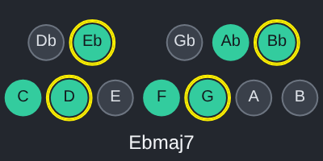

# ScaleView for Ableton Live

A Max for Live MIDI effect. It is `reascripts/ScaleView Pro.lua` itself, unchanged, running on Middaw's Lua 5.4 runtime, drawn on the device: the key at a glance, its notes spelled for the key, and the chord you play named underneath.

## Installing

Needs **Live 12.1 or later with Max for Live** (Live Suite, or Standard with
the add-on): the device runs on Max 9's JavaScript engine (`[v8ui]`).

1. Copy `ScaleView.amxd`, `ScaleView.js` and `ScaleView.maxpat` into one folder, for
   example `Music/Ableton/User Library/Presets/MIDI Effects/Max MIDI Effect/`. The `.amxd` finds
   `ScaleView.js` beside it.
2. Drag `ScaleView.amxd` onto a MIDI track, in front of an instrument.
3. Optional: open it in the Max editor and click **Freeze Device**, then save.
   The device then carries the script inside it and can be moved on its own.

## Using it

| | |
| --- | --- |
| The circles | Click a note for the scale list, anywhere else for the options, exactly as in REAPER. |
| The chord | Notes played into the device (from the track's MIDI) are named under the circles. They pass straight on to the instrument after it. |

The scale and the options are kept with the Live set (the script's ExtState and ProjExtState).

## How it is built

`ableton/device.json` describes the device; `python3 ableton/kit/build.py
ableton/device.json` writes the `.amxd`, the `.maxpat` and the script bundle
`ScaleView.js`. The bundle is Middaw's Lua 5.4 runtime, `reascripts/ScaleView Pro.lua`, and the shared host (`ableton/kit/lua_device.js`, `gfx.js`). See `ableton/kit/VENDORED.md`.

`node --test ableton/tests/test_device.js` runs the device on a pretend Max and Live: the twelve notes drawn, a click opening the scale list and the scale chosen shown and spelled (Eb major with flats), a menu closed with nothing chosen, a chord played into the device named under the key and passed on, and the scale kept with the set. `node ableton/window.js` redraws the picture above from the device's own drawing code (it needs Playwright's Chromium).

## Limits

- **It has not been opened in Live yet.** It is tested in Node against a stand-in for Max and the Live Object Model; nothing has run in Max. If the `.amxd` will not open, open `ScaleView.maxpat` in Max and save it as a device.
- Keys reach the script only while its window has focus, through Max's `[key]`.
- It keeps its own scale, as in REAPER; it does not follow Live 12's Scale setting.
- ScaleView Simple is not built as a device; Pro is the one to use.
